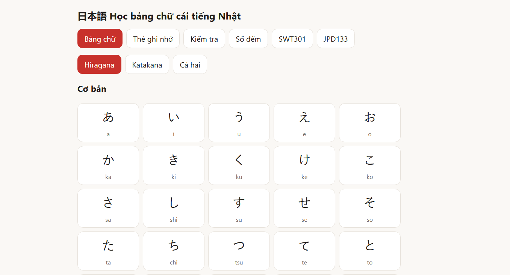

# Japanese Study App 日本語

🇬🇧 English | [🇻🇳 Tiếng Việt](README.vi.md)

A web app for studying Japanese: Hiragana/Katakana charts, a number-counting table, and multiple-choice practice banks for the SWT301 and JPD133 courses. Pure HTML/CSS/JavaScript, just open `index.html` in a browser.



## Project structure

```
japanese-study-app/
├── index.html            # Page shell
├── assets/
│   └── screenshot.png    # App screenshot
├── css/
│   └── style.css         # Styles
├── js/
│   ├── kana.js           # Kana charts, flashcards, kana quiz
│   ├── numbers.js        # Number counting
│   ├── ai.js             # AI hints
│   ├── bank.js           # Question banks, custom test builder
│   ├── translate.js      # Translate on text selection
│   └── app.js            # Tab switching, startup
├── data/
│   ├── swt301.json       # SWT301 questions
│   ├── jpd133.json       # JPD133 questions
│   └── *.js              # Auto-generated from JSON
├── scripts/
│   └── build_data.py     # JSON -> JS
├── README.md             # English
└── README.vi.md          # Tiếng Việt
```
