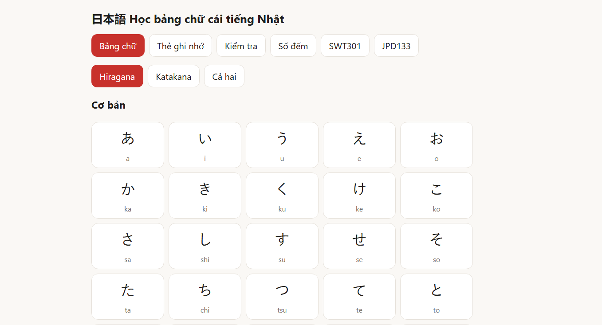

# Japanese Study App 日本語

[🇬🇧 English](README.md) | 🇻🇳 Tiếng Việt

Ứng dụng web giúp ôn tiếng Nhật: học bảng chữ cái Hiragana/Katakana, bảng số đếm và luyện đề trắc nghiệm SWT301, JPD133. Thuần HTML/CSS/JavaScript, mở `index.html` bằng trình duyệt là chạy.



## Cấu trúc dự án

```
japanese-study-app/
├── index.html            # Khung trang
├── assets/
│   └── screenshot.png    # Ảnh giao diện
├── css/
│   └── style.css         # Giao diện
├── js/
│   ├── kana.js           # Bảng chữ cái, thẻ ghi nhớ, kiểm tra
│   ├── numbers.js        # Số đếm
│   ├── ai.js             # AI gợi ý
│   ├── bank.js           # Ngân hàng câu hỏi, tạo bài kiểm tra
│   ├── translate.js      # Dịch khi bôi đen
│   └── app.js            # Chuyển tab, khởi tạo
├── data/
│   ├── swt301.json       # Câu hỏi SWT301
│   ├── jpd133.json       # Câu hỏi JPD133
│   └── *.js              # Sinh tự động từ json
├── scripts/
│   └── build_data.py     # json -> js
├── README.md             # English
└── README.vi.md          # Tiếng Việt
```
